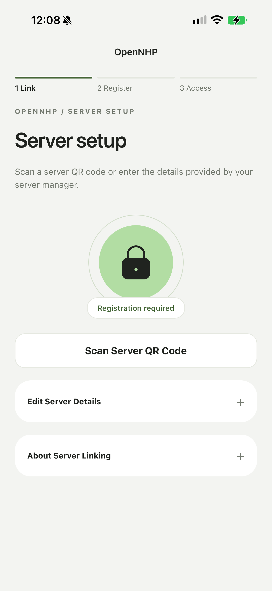
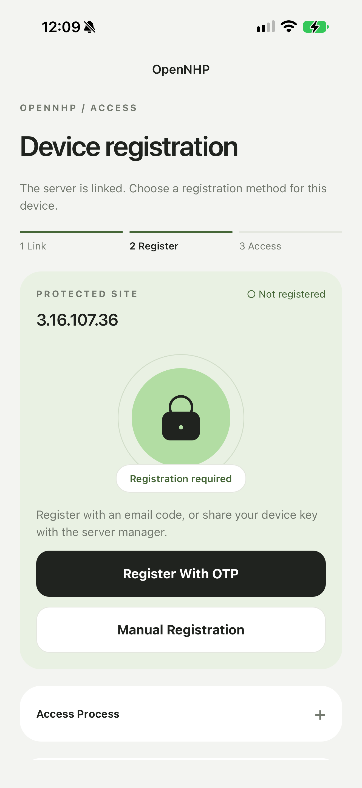
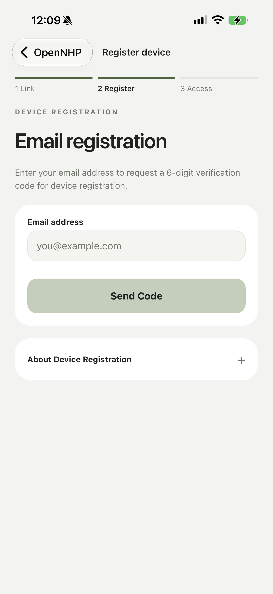
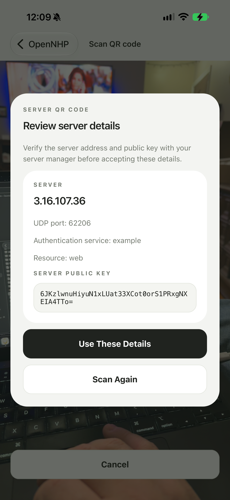
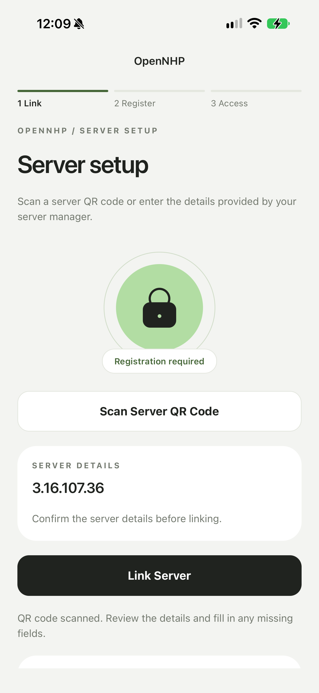

# OpenNHP React Native Demo

> [!IMPORTANT]
> This app uses [`react-native-opennhp`](https://github.com/justingreerbbi/react-native-opennhp), which is **under active development**. This repository is **solely a demo app at this time**. It is intended for development and testing, not production use.

A React Native app for testing server linking, device registration, and access requests with OpenNHP on iOS and Android.

**Repository:** [justingreerbbi/react-native-opennhp-app-demo](https://github.com/justingreerbbi/react-native-opennhp-app-demo)

## App preview

Link a server, choose a registration method, and register the device with an email verification code.

<table>
  <thead>
    <tr>
      <th width="33%">Dashboard</th>
      <th width="33%">Linked server</th>
      <th width="33%">OTP registration</th>
    </tr>
  </thead>
  <tbody>
    <tr>
      <td align="center" valign="top">
        <a href="docs/images/dashboard.png"></a>
      </td>
      <td align="center" valign="top">
        <a href="docs/images/linked-server.png"></a>
      </td>
      <td align="center" valign="top">
        <a href="docs/images/otp-registration.png"></a>
      </td>
    </tr>
    <tr>
      <td align="center"><a href="#configure-a-server">Scan or enter server details</a></td>
      <td align="center"><a href="#register-a-device">Choose a registration method</a></td>
      <td align="center"><a href="#register-a-device">Request an email code</a></td>
    </tr>
  </tbody>
</table>

<sub>Select an image to view it at full size.</sub>

## Contents

- [App preview](#app-preview)
- [Requirements](#requirements)
- [Download and install](#download-and-install)
- [Build for iOS](#build-for-ios)
- [Build for Android](#build-for-android)
- [Configure a server](#configure-a-server)
- [Register a device](#register-a-device)
- [Development commands](#development-commands)
- [Project structure](#project-structure)
- [Troubleshooting](#troubleshooting)
- [Contributing and community](#contributing-and-community)
- [Development notes](#development-notes)

## Requirements

This is a native React Native project. Build it using the iOS or Android toolchain; it does not run in Expo Go.

| Requirement | Details |
| --- | --- |
| Git | Required to clone this repository and install its Git-based module dependency. |
| Node.js and npm | Use Node **22.13+ within the 22.x release line**, **24.3+ within 24.x**, or **26+**, matching the installed React Native 0.88 requirement. |
| iOS development | macOS, Xcode with command-line tools and an iOS Simulator runtime, Ruby, Bundler, and CocoaPods. The installed React Native tooling requires Xcode 16.1 or later; use a version compatible with your selected SDK and device. |
| Android development | Android Studio, JDK 17, and the Android SDK/NDK versions configured below. Supported host platforms are macOS, Windows, and Linux. |
| OpenNHP server | A reachable server, its address, UDP port, server key, and the appropriate authentication service and resource settings. Needed to test registration and access requests. |

### Platform configuration

| Setting | Current value |
| --- | --- |
| React Native | `0.88.0` |
| iOS deployment target | iOS `15.1` |
| iOS bundle identifier | `org.reactjs.native.example.OpenNHPAgent` |
| Android application ID | `com.opennhpagent` |
| Android minimum SDK | `24` — Android 7.0 |
| Android compile SDK / target SDK | `37` / `36` |
| Android Build Tools | `37.0.0` |
| Android NDK | `27.1.12297006` |
| Gradle | `9.4.1`, supplied through the checked-in wrapper |

Install the Android platform, Build Tools, and NDK versions through Android Studio’s **SDK Manager**. The project files are the source of truth if these versions change: [package.json](package.json), [android/build.gradle](android/build.gradle), and [ios/Podfile](ios/Podfile).

For initial toolchain setup, follow the [React Native environment setup guide](https://reactnative.dev/docs/set-up-your-environment).

## Download and install

### 1. Clone the repository

```sh
git clone https://github.com/justingreerbbi/react-native-opennhp-app-demo.git
cd react-native-opennhp-app-demo
```

Alternatively, use **Code → Download ZIP** on GitHub, extract the archive, and open a terminal in the extracted folder. Git must still be installed because npm uses it to fetch `react-native-opennhp`.

### 2. Install JavaScript dependencies

Run this from the project root:

```sh
npm ci
```

This installs the dependencies recorded in `package-lock.json`, including the GitHub-hosted `react-native-opennhp` module. A separate module installation is not needed.

Continue with the build instructions for your platform.

## Build for iOS

### 1. Install Ruby and native dependencies

From the project root:

```sh
bundle config set --local path vendor/bundle
bundle install
cd ios
bundle exec pod install
cd ..
```

The local Bundler configuration and installed dependencies are ignored by Git. Run `bundle exec pod install` from `ios` again after changing native dependencies.

### 2. Start Metro

In a terminal at the project root:

```sh
npm start
```

Leave this terminal running.

### 3. Run in the simulator

In a second terminal at the project root:

```sh
npm run ios
```

The simulator can be used for the app’s setup screens and network flows. QR scanning requires a physical device with a camera; enter server details manually in the simulator.

### Run on a physical iPhone

1. Open the CocoaPods workspace:

   ```sh
   open ios/OpenNHPAgent.xcworkspace
   ```

2. Connect your iPhone and select it as the run destination in Xcode.
3. Select the **OpenNHPAgent** target and open **Signing & Capabilities**.
4. Choose your Apple development team and configure signing. The current bundle identifier is `org.reactjs.native.example.OpenNHPAgent`; use a matching provisioning profile, or change the identifier to one registered to your team.
5. Enable Developer Mode on the iPhone if prompted, then build and run from Xcode. Keep Metro running for a Debug build.

Open the `.xcworkspace`, rather than the `.xcodeproj`, so Xcode includes the installed CocoaPods dependencies. Certificates, provisioning profiles, and personal signing settings are not supplied by this repository.

## Build for Android

### 1. Prepare a target device

Choose either:

- **Emulator:** create and start an Android Virtual Device in Android Studio.
- **Physical device:** enable Developer Options and USB debugging, connect the device, and authorize the computer when prompted.

Confirm that the target is visible:

```sh
adb devices
```

### 2. Start Metro

In a terminal at the project root:

```sh
npm start
```

### 3. Build and run

In a second terminal at the project root:

```sh
npm run android
```

On Windows, run the same npm commands from PowerShell or Command Prompt. The project includes `gradlew.bat` for Gradle tasks.

The repository includes the standard Android debug keystore for local development. The current release configuration also references that debug key; configure your own release signing before distributing an Android build.

## Configure a server

Fresh installs do not contain a preconfigured server address, UDP port, or server key. The OpenNHP server is a separate service and is not installed by this app.

### Set up a test server quickly

For a quick Ubuntu test setup, use the [OpenNHP Ubuntu Installer](https://github.com/OpenNHP/OpenNHP-Ubuntu-Installer). It installs and configures the server and access controller, offers an optional demo website, and provides helpers for device registration and exporting server settings as a QR code.

Follow its [Quickstart](https://github.com/OpenNHP/OpenNHP-Ubuntu-Installer#quickstart) on a separate test server, then use the exported connection settings in this app. Check the installer’s current host requirements and firewall instructions before running it. One-time registration must be enabled for OTP testing; email delivery requires separate SMTP configuration.

### Link the app to your server

1. Obtain connection details from your server manager.
2. Choose **Scan Server QR Code**, or open **Edit Server Details** to enter them manually.
3. For scanned details, review the confirmation modal and choose **Use These Details**.
4. Review the server settings and choose **Link Server**. This button appears only when the required details are valid.

Settings are stored on the device. Use **Unlink Server** under **Server & Device Details** to remove the linked server and its saved registration.

<table>
  <thead>
    <tr>
      <th width="50%">Confirm scanned details</th>
      <th width="50%">Review before linking</th>
    </tr>
  </thead>
  <tbody>
    <tr>
      <td align="center" valign="top">
        <a href="docs/images/qr-confirmation.png"></a>
      </td>
      <td align="center" valign="top">
        <a href="docs/images/server-review.png"></a>
      </td>
    </tr>
    <tr>
      <td align="center">Verify the scanned information before accepting it.</td>
      <td align="center">Link the server after reviewing its details.</td>
    </tr>
  </tbody>
</table>

### QR package format

The preferred QR code contains a JSON object with these fields:

| Field | Type | Requirement |
| --- | --- | --- |
| `schemaVersion` | Number | Must be `1`. |
| `host` | String | Hostname or IPv4 address, without a URL scheme, port, or path. |
| `port` | Number | Integer from `1` to `65535`. |
| `serverPublicKey` | String | Canonical base64 encoding of a 32-byte server key. |
| `authServiceId` | String | Authentication service identifier. |
| `resourceId` | String | Protected resource identifier. |

Example structure — replace the host, key, and identifiers with your server’s actual values before generating a QR code:

```json
{
  "schemaVersion": 1,
  "host": "nhp.example.com",
  "port": 62206,
  "serverPublicKey": "<base64-server-key-from-your-server-manager>",
  "authServiceId": "example",
  "resourceId": "web"
}
```

The placeholder key above is intentionally not valid. Service and resource identifiers must start with a letter or digit, contain only letters, digits, `.`, `_`, or `-`, and be at most 128 characters long.

The scanner validates the package before showing confirmation. Settings are validated again before saving and generating native configuration. These checks validate format and safe values; they do not prove server ownership or QR authenticity. Obtain QR codes from a trusted server manager.

Legacy complete JSON packages using `{host, port, pubkey}` and bare base64 server keys are also supported. A bare key requires the host and port to be entered manually. Manual entry and legacy packages without service/resource identifiers use the demo defaults: authentication service `example` and resource `web`.

## Register a device

After linking a server, select a registration method:

| Method | Steps |
| --- | --- |
| **Register With OTP** | Enter an email address, select **Send Code**, then enter the 6-digit code to register the device. The server must support the registration flow and email delivery. |
| **Manual Registration** | Select **Copy Device Key** and send the key to your server manager. Ask them to register the device and grant the required resource access. |

Copying the device key does not register the device automatically. The current app uses the saved email registration record to enable **Request Access & Open Site**; manual registration provides key sharing and instructions, but does not yet include an in-app completion or status check.

After successful OTP registration, choose **Request Access & Open Site** to send an OpenNHP access request. The app opens `http://<server-host>/` if the server grants access. This demo assumes that the protected website is available at the linked server’s host.

## Development commands

Run these from the project root:

| Command | Purpose |
| --- | --- |
| `npm start` | Start the Metro development server. |
| `npm run ios` | Build and run the iOS app. |
| `npm run android` | Build and run the Android app. |
| `npm test -- --runInBand` | Run the Jest tests. |
| `npm run lint` | Check JavaScript and TypeScript with ESLint. |
| `npx tsc --noEmit` | Check TypeScript types without generating output. |

## Project structure

| Path | Contents |
| --- | --- |
| `App.tsx` | Navigation and app entry component. |
| `src/screens/` | Server setup, QR scanning, registration, and access screens. |
| `src/agent.ts` | OpenNHP module integration and registration/access operations. |
| `src/serverStore.ts` | Server package validation and device-local settings storage. |
| `src/connection.ts` | Demo service defaults, cluster/organization IDs, and site URL behavior. |
| `src/ui/` | Shared UI components and theme. |
| `__tests__/` | Automated tests. |
| `docs/images/` | Screenshots used in this README. |
| `ios/` | Xcode workspace, project, and CocoaPods configuration. |
| `android/` | Android project and Gradle wrapper. |

Dependency lockfiles are included for repeatable installs. Installed dependencies (`node_modules`, Pods, and Ruby gems), generated builds, local environment settings, and private signing files are excluded by [.gitignore](.gitignore).

## Troubleshooting

| Problem | What to check |
| --- | --- |
| Dependency installation fails | Confirm the Node version meets the React Native requirement, Git is installed, and the machine can access GitHub and the package registries. Use `npm ci` with the checked-in lockfile. |
| iOS native module is missing | Run `bundle exec pod install` from `ios`, then rebuild the app using the workspace. A Metro reload alone does not install native modules. |
| iPhone build fails during signing | Check the selected team, bundle identifier, provisioning profile, and device registration in Xcode. |
| Android SDK is not found | Set `ANDROID_HOME` to your SDK directory or configure `sdk.dir` in the ignored `android/local.properties` file. |
| Android tools or licenses are missing | Install the configured SDK, Build Tools, and NDK versions in SDK Manager, then accept the required Android SDK licenses. |
| Debug app cannot reach Metro | Keep Metro running. For a USB-connected Android device, try `adb reverse tcp:8081 tcp:8081`. For an iPhone, check that the device can reach the development computer. |
| Camera or QR scanning is unavailable | Use a physical camera device, allow camera permission, and check that the QR contains a supported package. The iOS simulator has no camera. |
| Registration or an access request fails | Confirm the server address, UDP port, server key, service/resource IDs, and server-side registration support. Check network reachability and UDP firewall rules. |
| A local server is unreachable | A physical device’s `localhost` refers to that device. Use the computer’s reachable LAN address. The Android emulator uses `10.0.2.2` to reach the host computer. On iOS, check local-network privacy configuration and permission when using a LAN server. |
| Email code has not arrived | Check the email address, spam folder, and server SMTP configuration. For local testing, check the server log for the verification code. |

## Contributing and community

See the [contributing guide](.github/CONTRIBUTING.md) for issue reporting, development checks, and pull requests. Participation is covered by the [Code of Conduct](.github/CODE_OF_CONDUCT.md). Both documents use OpenNHP’s upstream community guidelines as their reference and adapt them to this demo app.

## Development notes

This app and its native module are evolving together. Review the [module documentation](https://github.com/justingreerbbi/react-native-opennhp) for SDK behavior and current limitations. See the [OpenNHP documentation](https://docs.opennhp.org) for server setup.

Current follow-up work:

- Align QR generator parameter names with the server’s provisioning format.
- Review additional scanner schema identification requirements.
- Define a way to verify QR authenticity through an open protocol.
- Complete the manual registration flow with an in-app status or completion step.
