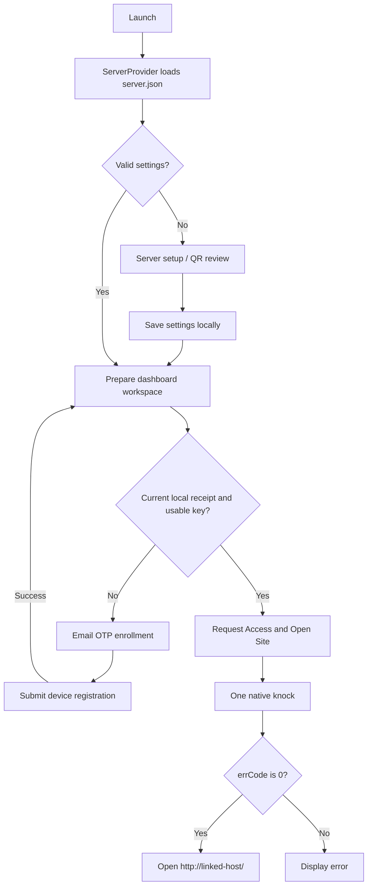
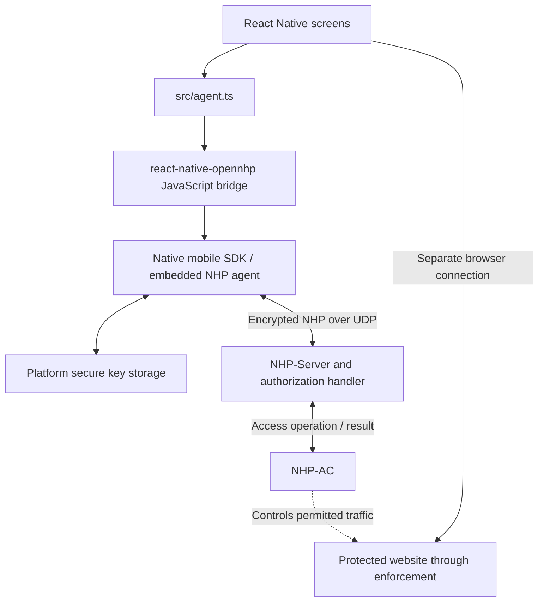
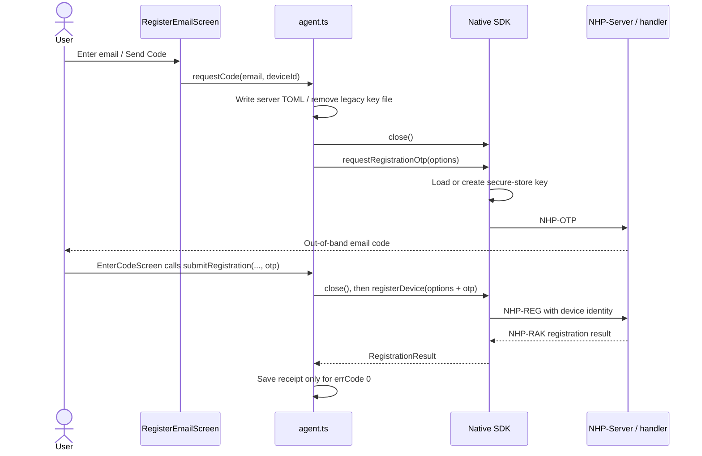
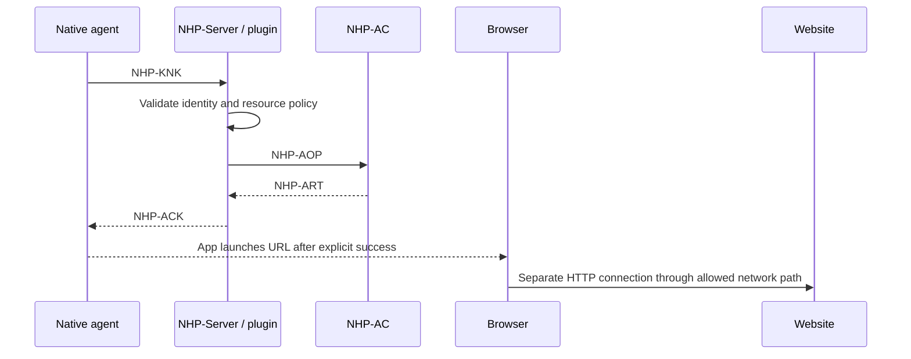

# OpenNHP implementation guide

This guide explains the implementation in this React Native demo. It describes
current behavior, including its limitations; proposed password/proxy/token flows
are extension ideas, not existing functionality. Start here, then follow the
linked functions in the source. No server configuration or runtime deployment is
included in this app.

## 1. The three stages

| Stage | What the app does | What it does not establish |
| --- | --- | --- |
| Link | Saves a server host, UDP port, public key, and optional service/resource IDs | Reachability, device enrollment, or access permission |
| Register | Requests an email OTP, then submits it with the native device identity | An open connection to the protected resource |
| Knock | Requests permission for one resource through the native agent | Application login or encryption of later HTTP traffic |

A locally saved registration is a receipt used by the UI. The NHP server remains
authoritative and can reject a later knock after revocation or policy changes.



## 2. Source map and reading order

| File | OpenNHP responsibility |
| --- | --- |
| [App.tsx](../App.tsx) | Selects setup or linked-server navigation from local state |
| [ServerContext.tsx](../src/ServerContext.tsx) | Loads, links, and unlinks the single configured server |
| [serverStore.ts](../src/serverStore.ts) | Validates QR/manual/disk settings and saves `server.json` |
| [connection.ts](../src/connection.ts) | Default service/resource IDs, local cluster name, organization, server peer expiry, demo URL |
| [agent.ts](../src/agent.ts) | App-to-native boundary: workspace, key migration, OTP, registration, and knock |
| [ServerSetupScreen.tsx](../src/screens/ServerSetupScreen.tsx) | Collects/reviews server settings and calls `link` |
| [ScannerScreen.tsx](../src/screens/ScannerScreen.tsx) | Parses QR payloads, asks for review, passes values to setup |
| [RegisterEmailScreen.tsx](../src/screens/RegisterEmailScreen.tsx) | Calls `requestCode` |
| [EnterCodeScreen.tsx](../src/screens/EnterCodeScreen.tsx) | Calls `submitRegistration` |
| [ManualRegisterScreen.tsx](../src/screens/ManualRegisterScreen.tsx) | Displays/copies the device public key for an administrator |
| [DashboardScreen.tsx](../src/screens/DashboardScreen.tsx) | Local readiness gate, calls `knockWeb`, opens browser on success |
| [navigation.ts](../src/navigation.ts) | Typed routes; email is the registration screen parameter |

UI components and theme files render the interface; they do not implement NHP
cryptography or access decisions.

## 3. JavaScript versus native versus server



The TypeScript app does not construct encrypted packets, access firewall rules,
or implement the server plugin. The dependency bundles the native iOS/Android
SDKs. It performs key operations and NHP transport. The server evaluates identity
and policy, and NHP-AC applies network enforcement near the protected resource.

Inspect the installed module's `README.md`, `docs/api.md`, `src/index.d.ts`, and
`OPENNHP_REVISION` when debugging the native boundary. These are dependency files,
not app source. The installed module documents a native registration patch on top
of its recorded upstream revision. Its OTP APIs must be paired with compatible
server behavior; do not assume every upstream SDK release exports them.

## 4. Provisioning and server identifiers

`parseServerPayload` accepts three formats:

1. Version-1 JSON with `schemaVersion`, `host`, `port`, `serverPublicKey`,
   `authServiceId`, and `resourceId`.
2. Legacy complete JSON using exactly one of `pubkey`, `pubKey`, or `key`.
3. A bare server public key, which leaves host/port for manual entry.

It bounds input at 4096 characters, rejects unknown package fields, and checks
field types without coercing them. `sanitizeServerConfig` normalizes allowed
fields and validates DNS/IPv4 host names, an integer UDP port from 1 through
65535, canonical base64 for a 32-byte key, and restricted service/resource IDs.
IPv6 addresses, URL schemes, URL paths, and host:port strings are not accepted as
hosts. Public-key syntax validation does not prove QR authenticity or ownership.

`ScannerScreen` pauses scanning while showing a review modal. Accepting that
modal only fills the setup screen. `ServerSetupScreen.onLink` calls the context's
`link`, which validates and saves the settings. `App.tsx` then switches stacks.
There is no server handshake at link time.

| Identifier | Meaning in this app |
| --- | --- |
| `host`, `port` | NHP UDP destination, not the protected website's URL |
| `pubkey` | Expected server public key |
| `authServiceId` / `ASP_ID` | Which server authorization service handles the request; default `example` |
| `resourceId` / `RES_ID` | Logical protected resource; default `web` |
| `CLUSTER` | Local SDK server-group name `opennhp`, matching TOML `Name` |
| `ORG_ID` | Identity/tenant context sent as `opennhp`; not a credential |
| `SERVER_KEY_EXPIRE` | Unix expiration of the configured server peer entry |

`ensureServerConfig` turns saved JSON into `<root>/etc/server.toml`. It uses `Ip`
for IPv4 or `Host` for DNS and sets `Name`, `PubKeyBase64`, `ExpireTime`, and the
instance UDP port. Registration and knocks pass `CLUSTER` to select that entry.
Settings are revalidated and TOML is rewritten before these operations.

## 5. Device identity and storage

| Data | Location | Purpose / lifecycle |
| --- | --- | --- |
| Device private key | iOS Keychain or Android Keystore-wrapped storage, managed by the dependency | Native cryptographic identity; normal key APIs return public key only |
| Device public key | Derived/read through native SDK; optionally copied into the registration receipt | Shareable key used to enroll/recognize the device |
| `server.json` | SDK working root | Linked peer settings; removed on unlink |
| `etc/server.toml` | SDK working root | Generated native peer configuration; remains after unlink |
| `device-id.txt` | SDK working root | Persistent installation label; remains after unlink |
| `registration.json` | SDK working root | Email, device ID, optional public key and expiry; local UI receipt |
| SDK logs | SDK-managed working directory | Diagnostics; enrollment currently requests DEBUG logging |

`workingDirectory` prefers the native SDK's default path and falls back to the
React Native filesystem document directory. A fallback path does not make a
missing native module functional.

`devicePublicKey` first reads the stored key. If unavailable/empty it calls
`generateKeys(Cipher.CURVE25519)`. Generating a key does not register it. Replacing
a registered key requires server enrollment for the replacement.

`loadDeviceId` creates a timestamp/random label and persists it. Its historical
`ios-` prefix is also used on Android. The label is not hardware attestation, a
password, or proof of key possession.

### Legacy migration and readiness

`removePlaintextAgentKey` detects a nonempty `PrivateKeyBase64` in the older
`etc/config.toml` and deletes that whole file. It does not import the old key.
`prepareWorkspace` then removes the legacy registration receipt so the UI can
enroll the secure-store identity.

For an otherwise current receipt, `storedKeyMatches` requires a stored public key
and compares it with the receipt's key when available. A mismatch returns no
registration to the dashboard without deleting the receipt file. Legacy receipts
without a public key accept any nonempty stored key. Expired receipts can be
returned by preparation; the dashboard separately rejects them for UI readiness.
These checks never query live server enrollment or revocation state.

## 6. Email OTP enrollment



Both calls use `registrationOptions`: working root, DEBUG log level,
Curve25519 preference, email, device ID, organization, `userData: {email}`,
service/resource IDs, and cluster. The app closes a running agent first so the
operation reloads the stored key and current peer configuration.

`requestCode` normalizes the SDK result but writes no receipt. Its success does
not prove email delivery. `RegisterEmailScreen` passes email to `EnterCodeScreen`;
the OTP is typed there and trimmed before submission. The UI requires six digits.

`submitRegistration` saves metadata only on explicit string `"0"` success after
normalization. A save error can occur after the server has already accepted the
key; local state and server state are not an atomic transaction. The UI navigates
back to the dashboard, whose focus handler reloads the receipt.

Manual registration only displays/copies a public key. An administrator must
register it and assign permission separately. This screen has no completion
check and creates no local receipt; the existing dashboard access gate still
expects the saved email registration flow.

## 7. The actual knock and resource connection

```text
DashboardScreen.onKnock()
  -> knockWeb(registeredEmail, deviceId)
     -> ensureServerConfig()
     -> removePlaintextAgentKey()
     -> devicePublicKey()
     -> close()
     -> initializeAgent(root, LogLevel.INFO)
     -> setKnockUser({userId, deviceId, orgId, userData: {email}})
     -> knockResource(aspId, resId, CLUSTER)  <-- native knock entry point
  -> check String(ack.errCode) === '0'
  -> Linking.openURL(siteUrl(config.host))
```

`setKnockUser` sets identity/context for the agent; it does not send the knock.
`knockResource` is the JavaScript entry point that invokes native NHP packet
construction and transport. Email is used as `userId`; device ID and organization
are context fields. Server policy must decide what those claims authorize.



The diagram shows the ordinary allow path, not every protocol branch. Cookie
challenges, temporary AC tokens, and pre-access steps depend on the native build
and deployment. The TypeScript screen does not implement these exchanges itself.

The SDK's `KnockAck` shape includes error information and optional `resHost`,
`opnTime`, `aspToken`, `agentAddr`, `acTokens`, `preActions`, and `redirectUrl`.
The screen checks only `errCode` and uses `errMsg` on failure. It does not route by
`resHost`, follow `redirectUrl`, schedule renewal from `opnTime`, or implement
pre-access actions. Check the pinned native SDK before assuming it handles an
optional pre-access flow automatically.

`siteUrl` always builds `http://<linked-host>/`. It assumes the website shares the
NHP host, uses the default HTTP port, and does not use the NHP UDP port. NHP access
permission does not add TLS to this HTTP connection or supply application login.
The app currently launches a browser rather than calling a REST resource API.

## 8. Error handling and expiration

| Condition | Handling |
| --- | --- |
| Invalid linked settings | Helper throws before native operation |
| Native initialization returns false | `knockWeb` throws startup error |
| SDK rejects / filesystem fails | Screen catches and displays an error |
| SDK returns a server failure result | Screen reads error code/message |
| Registration succeeds but receipt cannot save | Error displayed; server enrollment may already exist |
| Knock succeeds but browser launch fails | Screen reports failure; access may already have been granted |
| Server revokes a registered device | Local receipt can remain current; subsequent server decision is authoritative |

Three independent times must not be confused:

- `expiresAt`: registration receipt expiry, in Unix seconds. Missing means the
  app imposes no local deadline. No fixed 24-hour TTL is enforced by app code.
- `SERVER_KEY_EXPIRE`: server peer-entry expiry written to TOML.
- `opnTime`: access-window duration returned by the server, not currently used
  by the screen to display or renew access.

The app does not call `startKnockLoop`, schedule background renewal, or request
early exit with `exitResource`. Mobile suspension and Wi-Fi/cellular changes must
be addressed if renewal is added. A new egress address can require a new grant.

## 9. Unlink behavior

`ServerContext.unlink` attempts to close the agent, removes `server.json`, calls
`unlinkRegistration`, and clears context state. Registration deletion is best
effort and silently ignores errors. It retains the secure-store device key,
device ID, and generated server TOML. Later operations require valid linked
settings and rewrite TOML before use.

Unlink does not send a remote deregistration or explicit NHP exit. It should not
be described as immediate server-side revocation or guaranteed closure of an
existing access window.

## 10. Custom authentication extension points

These are implementation locations, not features already shipped in the app:

| Desired extension | App location | Required server work |
| --- | --- | --- |
| Credentials or short-lived grant in a knock | Extend `knockWeb` inputs and `setKnockUser.userData` | Plugin validates fields and binds authorization to authenticated device identity |
| Custom enrollment proof | Adapt `submitRegistration` / SDK enrollment options | Compatible registration handler; current API expects an OTP |
| Separate REST resource API | Replace dashboard browser launch with API client and explicit HTTPS URL | Protected listener/resource mapping plus API access-token validation |
| Session renewal | Add lifecycle-aware access orchestration | Grant expiry, revocation, and bounded access-window policy |

The existing credential example beside `setKnockUser` illustrates payload
extensibility only. There is no password field, credential proxy call, token
issuance, token refresh, or secret persistence implemented in this app. A custom
plugin must supply validation; a userData field is not proof of permission.
Device trust can be checked before the plugin receives a normal knock, so this
extension cannot be assumed to solve first-device enrollment automatically.

Do not put passwords or bearer tokens in server.json, registration.json, URLs,
or diagnostic logs. If transient credentials are added to native agent state,
define how that state is cleared/replaced after authentication. Retain separate
API authentication even when the network access rule is IP-based, especially
where multiple users share a NAT address.

## 11. Verification and investigation

The repository tests mock native behavior. They verify application orchestration
and validation, not actual UDP cryptography, SMTP delivery, server decisions, or
firewall enforcement. Review `__tests__/agent.test.ts`, `serverStore.test.ts`,
`Scanner.test.tsx`, and `App.test.tsx` alongside the helpers.

Useful local checks:

```sh
npm test -- --runInBand
npm run lint
npx tsc --noEmit
```

For a live failure, trace in order: validated peer settings -> native initialization
-> OTP/registration result -> server key trust -> selected ASP/resource -> plugin
authorization -> AC operation -> actual application destination and source address.
A successful knock does not prove that the configured website URL is correct.

Further references: [OpenNHP documentation](https://docs.opennhp.org/),
[protocol messages](https://docs.opennhp.org/protocol/messages/),
[server plugins](https://docs.opennhp.org/server_plugin/), and the installed
`react-native-opennhp` documentation. Prefer the installed revision and source
when investigating behavior that differs from newer online documentation.
